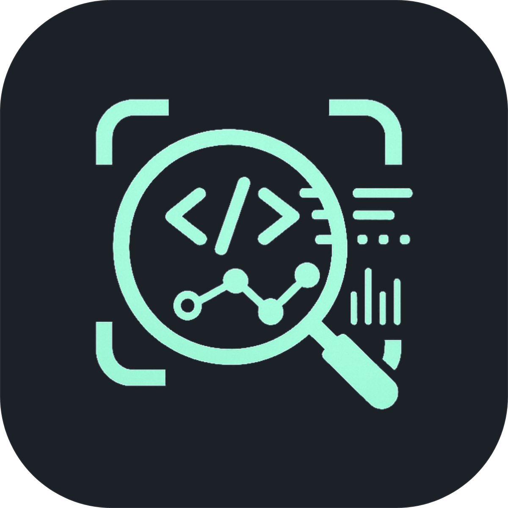
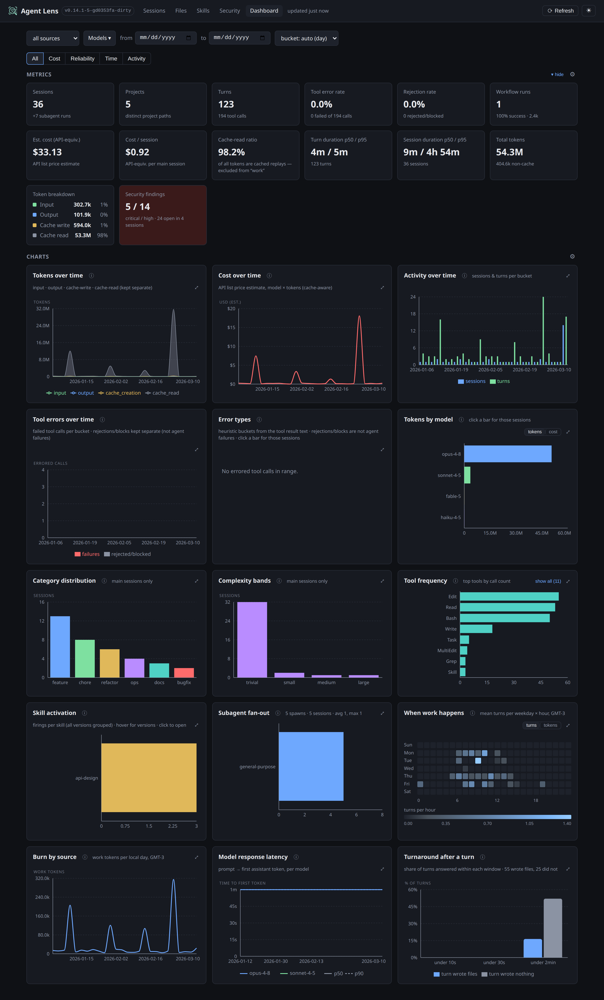
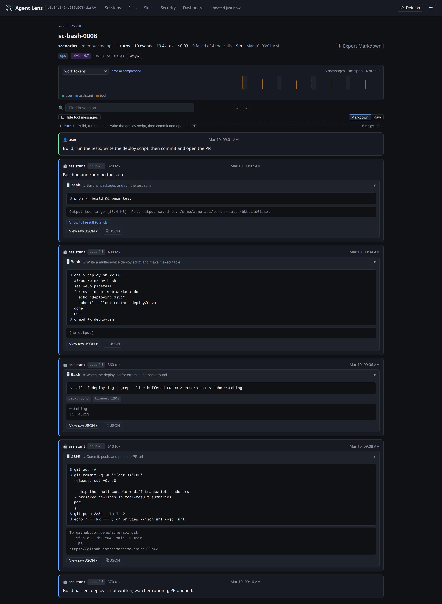
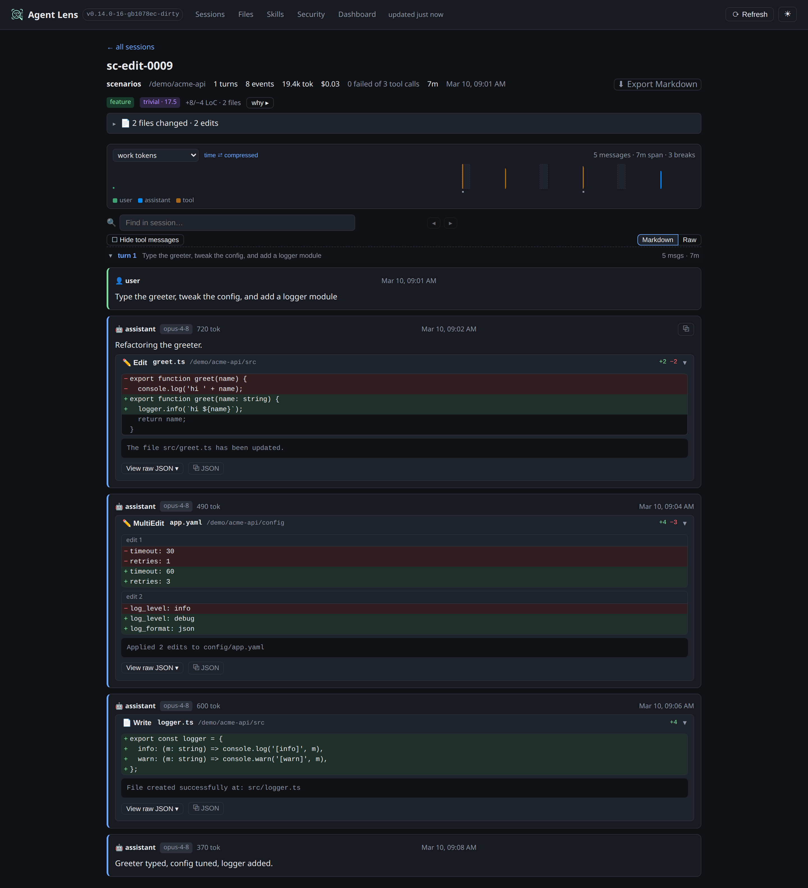
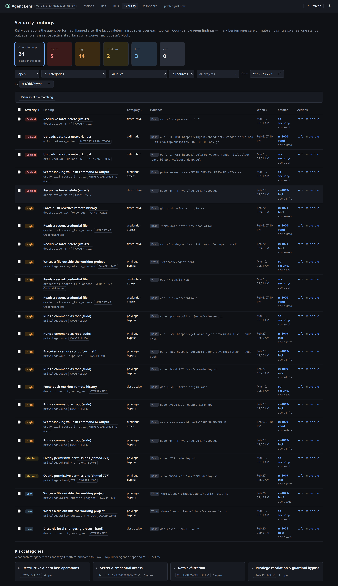

<div align="center">
  
  <h1>Agent Lens</h1>
  <p>Collect, search, and audit your Claude Code session traces. 100% local.</p>

[](https://www.npmjs.com/package/@swestash/agent-lens)
[](https://github.com/SWEStash/agent-lens/actions/workflows/ci.yml)


**[Live demo](https://swestash.github.io/agent-lens/)** · [Docs](docs/USAGE.md) · [Architecture](docs/ARCHITECTURE.md)

</div>

Claude Code records every session (what you asked, what the agent ran, what it changed) and prunes
those records after a rolling 30-day window. Agent Lens copies them into a local archive before they
expire, and gives you a transcript browser, usage and cost dashboards, and a deterministic, no-AI
audit of what the agent did on your machine. Nothing leaves your machine.

## Install

Requires [Node.js](https://nodejs.org/) 24 or later. Runs on Linux, macOS, and Windows.

```bash
npm install -g @swestash/agent-lens
```

Or run it without installing: `npx @swestash/agent-lens <command>`.

## Quick start

```bash
agent-lens collect --then-ingest   # copy your transcripts and build the database
agent-lens serve                   # open http://127.0.0.1:4477
```

No configuration is needed: by default Agent Lens collects `~/.claude`.

To keep it current, install it as OS services (systemd, launchd, or Task Scheduler). This runs
collection on a schedule and keeps the web UI up across reboots:

```bash
agent-lens service install
```

Or keep a foreground process that collects whenever a transcript changes: `agent-lens watch`.

See the [usage guide](docs/USAGE.md) for every command and option.

## Features

**Keep your history**
- Passive collection that never deletes and never copies credentials.
- Several Claude accounts side by side, each tagged as its own source.
- An archive that stays the source of truth: the database can always be rebuilt from it.

**Read any session**
- Transcripts split into turns, with tool-specific rendering: Bash as a shell console,
  `Edit`/`Write` as colored diffs, plans and questions as cards, workflow runs as a phase graph.
- A timeline under each session that shows where the work, the waiting, and the risky moments
  are. Click to jump, drag to filter.
- Full-text search across all sessions, and find-in-session that also reaches collapsed turns and
  hidden tool calls.
- Markdown export, redacted by default ([ADR-020](docs/decisions/ADR-020-redacted-export.md)).

**Audit what the agent did**
- **Security findings**: deterministic rules flag destructive commands, secret access,
  exfiltration, and guardrail bypasses, anchored to OWASP Agentic and MITRE ATLAS. Mark findings
  safe or mute a rule; triage survives rebuilds ([ADR-017](docs/decisions/ADR-017-security-findings.md)).
- **File provenance**: which session, and which turn, changed a file, with links to the exact tool
  call ([ADR-022](docs/decisions/ADR-022-file-modification-provenance.md)).
- **Tool errors**: failed tool calls per session and over time, with your own rejections kept apart
  from real failures ([ADR-019](docs/decisions/ADR-019-tool-error-observability.md)).

**See where the tokens went**
- Tokens, estimated cost, and activity over time, broken down by model, tool, skill, and subagent,
  and filtered by source, date range, and model.
- When you work (a weekday by hour heatmap), model response latency, and audit tiles such as edit
  failures per model.
- A heuristic, no-AI category and complexity for each session, with its inputs shown.
- Reported as observations, never as an efficiency score
  ([ADR-036](docs/decisions/ADR-036-dashboard-audit-endpoint.md)).

## Screenshots

From the [live demo](https://swestash.github.io/agent-lens/), which runs on synthetic data.









## How it works

1. **Collect** copies transcripts into the archive. It only adds; it never deletes.
2. **Ingest** parses the archive into SQLite. It is incremental and safe to rerun, and
   `agent-lens ingest --full` rebuilds everything from the archive.
3. **Serve** runs a local web UI over the database, bound to `127.0.0.1`.

Diagrams and details are in [ARCHITECTURE.md](docs/ARCHITECTURE.md).

## Configuration

To collect more than `~/.claude`, list your accounts in `agent-lens.config.json` in the data
directory (`agent-lens config` prints the path it reads):

```json
{
  "sources": [
    { "label": "personal", "agent": "claude-code", "configDir": "~/.claude" },
    { "label": "work",     "agent": "claude-code", "configDir": "~/.config/claude-work" }
  ],
  "exclude": ["~/scratch"]
}
```

`exclude` is optional: those projects are never collected or ingested. `agent-lens config` also shows every effective setting and where it came from. The port, the data
directory, and model pricing are covered in the [usage guide](docs/USAGE.md#configuration).

## Privacy

- Data is only copied between local paths. There are no network calls and no telemetry.
- The collector skips credentials such as `~/.claude/.credentials.json`.
- The server binds `127.0.0.1` and refuses a routable address unless you override it.
- The store is as sensitive as the transcripts. Keep it on an encrypted disk if you need protection
  at rest ([ADR-009](docs/decisions/ADR-009-retention-and-at-rest.md)).

See [ADR-005](docs/decisions/ADR-005-privacy-posture.md) for the full posture.

## Documentation

| Doc | What it covers |
|---|---|
| [USAGE.md](docs/USAGE.md) | Commands, configuration, the web UI, environment variables, HTTP API, troubleshooting |
| [ARCHITECTURE.md](docs/ARCHITECTURE.md) | Packages, data flow, the ingest pipeline, and the ADR index |
| [INGEST-RUNBOOK.md](docs/INGEST-RUNBOOK.md) | Running, rebuilding, and troubleshooting ingest |
| [VALIDATION.md](docs/VALIDATION.md) | How metric correctness is verified |
| [PERFORMANCE.md](docs/PERFORMANCE.md) | Benchmarks and the query-plan guard |
| [DEVELOPMENT.md](docs/DEVELOPMENT.md) | Building from source, tests, project layout, adding an agent |
| [RELEASING.md](docs/RELEASING.md) | Versioning and npm releases |
| [decisions/](docs/decisions/) | Architecture Decision Records |

## Contributing

Agent Lens has a single maintainer for now, so pull requests aren't accepted yet, but bug reports,
feature requests, and ideas are welcome. See [CONTRIBUTING.md](CONTRIBUTING.md) for how to send
them, and [DEVELOPMENT.md](docs/DEVELOPMENT.md) to build and run it from source.

## License

[MIT](LICENSE) © SWEStash
