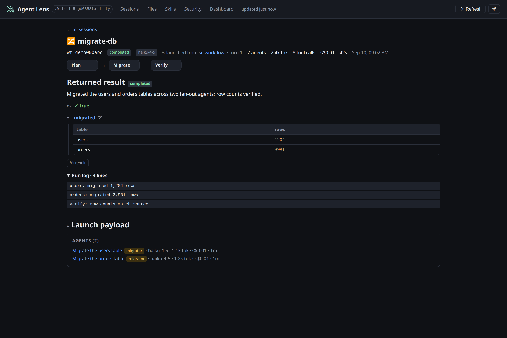

# Usage guide

Agent Lens is a three-stage local pipeline: **collect** copies transcripts into an archive,
**ingest** builds a SQLite store from it, and **serve** runs the web UI. Nothing leaves your machine.

- [Upgrade](#upgrade)
- [Configuration](#configuration)
- [Collect](#collect) · [Ingest](#ingest) · [Serve](#serve)
- [The web UI](#the-web-ui)
- [Export a session](#export-a-session)
- [Retention](#retention)
- [Reference](#reference): environment variables, paths, HTTP API
- [Troubleshooting](#troubleshooting)

Installation is in the [README](../README.md#install). From a source checkout, use
`node packages/cli/dist/agent-lens.js <command>` instead of `agent-lens <command>` (see
[DEVELOPMENT.md](DEVELOPMENT.md)).

## Upgrade

```bash
npm install -g @swestash/agent-lens@latest
agent-lens collect --then-ingest
```

Upgrades never destroy data. The archive is the source of truth and the database is derived from
it. A normal `ingest` applies additive schema changes on its own. Run `agent-lens ingest --full`
only when release notes ask for it.

If you run the services, restart the server after upgrading so the new code is live
(`systemctl --user restart agent-lens-server.service` on Linux, or restart the launchd or Task
Scheduler entry). The collector picks up the new binary on its next run.

## Configuration

Agent Lens works without a config file and collects `~/.claude`. Run `agent-lens config` to print
the effective settings, the paths it uses, and where each value came from.

The config file is looked up in this order:

1. `AGENT_LENS_CONFIG`
2. `<dataDir>/agent-lens.config.json` (see [Paths](#paths))
3. the repo's `agent-lens.config.json`, in a source checkout
4. the built-in default (`~/.claude`)

### Sources

A source is one agent account: a unique `label` plus its `configDir`.

```jsonc
// agent-lens.config.json
{
  "sources": [
    { "label": "personal", "agent": "claude-code", "configDir": "~/.claude" },
    { "label": "work",     "agent": "claude-code", "configDir": "~/.config/claude-work" }
  ]
}
```

- `label` names the archive folder and the source filter in the UI.
- `configDir` accepts `~` and `$HOME`.
- `agent` is `claude-code`, the only adapter shipped today. Adding another agent is covered in
  [DEVELOPMENT.md](DEVELOPMENT.md#add-another-agent).

To add an account later, add its entry and run `agent-lens collect --then-ingest`. It shows up as a
new source.

### Store path and server

```jsonc
{
  "sources": [ /* … */ ],
  "db": "~/lens/agent-lens.db",
  "server": { "port": 4477, "host": "127.0.0.1" }
}
```

Precedence is **flag > env > config file > default**. For example, `agent-lens serve --port 5599`
beats `AGENT_LENS_PORT`, which beats `server.port`, which beats 4477. `db` is used by `ingest`,
`metrics`, `serve`, and `export`, and the triage store (`triage.db`) sits beside it.

There is no `archive` or `triageDb` key. Those two hold data nothing can rebuild, so they stay inside
the data directory. To move them, move the data directory with `AGENT_LENS_DATA`
([ADR-021](decisions/ADR-021-fixed-data-layout.md)). The data directory can't be set in the config
file, because it's where the config file is looked up.

> [!NOTE]
> Don't add `db`, `server`, or `pricing` to `agent-lens.config.example.json`. That file is the
> fallback when no real config exists, so anything in it becomes live config for everyone who
> hasn't written their own. Copy it first, then add keys to your copy.

### Exclude projects

Keep playgrounds, throwaway tests, or private work out of Agent Lens entirely:

```jsonc
{
  "sources": [ /* … */ ],
  "exclude": ["~/git-projects/playground", "~/scratch"]
}
```

An excluded project is never collected, never ingested, and never put in the test corpus. If it was
ingested before you excluded it, the next ingest removes it. Matching is by real path, so a folder's
subfolders and subagent transcripts are excluded too. `AGENT_LENS_EXCLUDE` (comma-separated) adds
paths for a single run:

```bash
AGENT_LENS_EXCLUDE="$HOME/scratch" agent-lens ingest
```

### Model pricing

Cost is an estimate at API list prices, computed from token counts when you view it. A model missing
from the built-in price table counts as $0, and Agent Lens says so: the ingest report, `agent-lens
config`, and the About page list unpriced models, and an affected session cost shows as `$0.79 ⚠`.

Add or override rates in the config:

```jsonc
{
  "sources": [ /* … */ ],
  "pricing": {
    // USD per 1M tokens, keyed by model-id prefix; the longest prefix wins.
    "claude-opus-5": { "input": 5, "output": 25 },
    // cacheWrite and cacheRead are optional (default: 1.25x and 0.1x of input).
    "claude-opus-5-internal": { "input": 0, "output": 0, "cacheWrite": 0, "cacheRead": 0 }
  }
}
```

Your entries overlay the built-in table. An entry without a numeric `input` and `output` is ignored
and reported by `agent-lens config`. Prices are list prices only: no promotional rates, and no view of
subscription quota ([ADR-028](decisions/ADR-028-model-pricing.md)).

## Collect

Copies each source's transcripts into `<dataDir>/archive/<label>/` before Claude Code prunes them
(after a rolling 30-day window). It never deletes and never copies credentials. When a transcript
shrinks or diverges, the previous version is kept under `.versions/`.

```bash
agent-lens collect                 # one pass
agent-lens collect --then-ingest   # collect, then ingest
```

To keep collecting, either install the collector as an OS service or run `watch`:

```bash
agent-lens service install collector                  # runs at 9, 13, 17 and 21 by default
agent-lens service install collector --times 8,12,18  # custom hours (0 to 23)
agent-lens service status collector
agent-lens service uninstall collector                # the archive is left alone

agent-lens watch                   # collect and ingest whenever a source changes
agent-lens watch --interval 900    # also at least every 15 minutes
agent-lens watch --poll            # polling, for network filesystems
```

The service is a systemd user timer on Linux, a launchd agent on macOS, and Task Scheduler tasks on
Windows. A lock file (`<dataDir>/.agent-lens.lock`) keeps scheduled and `watch` runs from overlapping.

## Ingest

Parses the archive, including `.versions/` backups (deduplicated by event `uuid`), into
`<dataDir>/agent-lens.db`.

```bash
agent-lens ingest            # incremental: only changed files and the sessions they touch
agent-lens ingest --full     # drop the tables and rebuild everything from the archive
```

When to use `--full`, what a run prints, and how to troubleshoot it are in the
[ingest runbook](INGEST-RUNBOOK.md). How it works is in
[ARCHITECTURE.md](ARCHITECTURE.md#3-ingest-runtime-stage-2).

### Metrics

Ingest also classifies sessions, detects security findings, types tool errors, and indexes file
changes. To redo only those steps on an existing store, without rereading the archive:

```bash
agent-lens metrics
```

## Serve

```bash
agent-lens serve                      # http://127.0.0.1:4477, in the foreground
agent-lens serve --port 5599          # or set AGENT_LENS_PORT, or server.port in the config

agent-lens service install server     # run it in the background, restarted on failure
agent-lens service status server
agent-lens service uninstall server
```

`agent-lens service install` with no target installs both the collector and the server.

**What the service remembers.** A scheduler doesn't inherit your shell environment, so on Linux and
macOS `service install` writes into the unit any port or host you set explicitly, plus
`AGENT_LENS_DATA` and `AGENT_LENS_CONFIG` if set, and prints each value. Without that, the collector
could write to a different store than the one your commands read. After changing any of them, run
`service install` again.

On Windows, Task Scheduler can't store environment variables, so `service install` prints the `setx`
commands to run instead. The Windows task starts at logon and is not restarted after a crash.

## The web UI

The top bar has five views: **Sessions**, **Files**, **Skills**, **Security**, and **Dashboard**. It
also shows when data was last ingested, a **Refresh** button that runs collect and ingest
([ADR-015](decisions/ADR-015-refresh-action-endpoint.md)), and a light/dark theme toggle.

Try every view in the [live demo](https://swestash.github.io/agent-lens/), which runs on synthetic
data.

### Sessions

- **Filter** by source, project, model, kind (main or subagent), security severity, and error type.
- **Search** the full text of every transcript. All words must appear. Opening a result carries the
  search into the session.
- **Sort** by any column, and pick columns with the **Columns** control. Cost is hidden by default.

### A session



- **Transcript.** Split into turns, with tool-specific rendering, a category and complexity badge
  (with the signals behind it), and an error summary such as *3 failed · 1 declined/blocked
  of 40 tool calls*. Failed and declined are told apart by a heuristic
  ([ADR-019](decisions/ADR-019-tool-error-observability.md)).
- **Tokens per message.** Each message shows the tokens of the response it belongs to, with the full
  split on hover ([ADR-032](decisions/ADR-032-per-event-token-attribution.md)).
- **Timeline.** A minimap of the session. Bar height is tokens, color is the message type, and a rail
  marks failed tool calls, findings, file changes, and subagent spawns. A line shows how full the
  context was.
  - Idle gaps over a minute are collapsed; `time ⇄` switches to real time, and double-clicking a gap
    opens just that one.
  - Hover a mark for its details, click to jump to it, or drag to filter the transcript to a time
    range. The range is kept in the URL (`?from=`, `?to=`).
  - Keyboard: `←`/`→` move, `Home`/`End` jump to the ends, `Enter` opens, `Shift+←`/`→` selects a
    range, `Esc` clears it.
- **Find in session** (`/`). A case-insensitive substring search over message text, thinking, and
  tool inputs and results, two characters minimum. `Enter` and `Shift+Enter` step through matches and
  reveal hidden ones: collapsed turns, clamped messages, closed thinking blocks, and tool calls hidden
  by **Hide tool messages**. The term is kept in the URL (`?q=`)
  ([ADR-030](decisions/ADR-030-in-session-search.md)).
- **Export** to Markdown (⬇), redacted by default. See [Export a session](#export-a-session).
- **Copy archive path** copies the path of the session's archived `.jsonl`, so another local agent
  can read it, even after Claude Code has pruned the original. It isn't in the static demo.
- **Files changed** lists each file the session edited, with line counts and links to its history.

### Files

Which sessions, and which turns, changed each file
([ADR-022](decisions/ADR-022-file-modification-provenance.md)). Filter by path, source, and project,
then open a file for its timeline, where each change links to the exact tool call.

The index comes from successful `Edit`, `Write`, and `NotebookEdit` calls, plus Bash writes whose
target is clear from the command (heredoc, `tee`, `sed -i`, a redirect). Writes from inside scripts,
your own editor, formatters, and other machines aren't captured, and deletions and renames aren't
tracked yet. Treat it as agent provenance, not a full file history.

### Dashboard

Filter everything by source, date range, and model. Each card has an **ⓘ** that explains its
numbers and caveats, and a **⤢** that opens it full width.

- **KPIs**: sessions, tokens (input, output, cache write, cache read), estimated cost, and
  cache-read ratio.
- **Over time**: tokens, cost, and activity, bucketed by day, week, or month to fit the date range.
- **Breakdowns**: by model, category, complexity, tool, skill, subagent type, and error type.
  Category and complexity count main sessions only.
- **Tool errors**: failures over time and by type, with rejections and guardrail blocks kept apart.
- **When work happens**: a weekday by hour heatmap of turns or tokens
  ([ADR-034](decisions/ADR-034-heatmap-metric.md)).
- **Burn by source**, **model response latency** (p50 and p90), and **turnaround after a turn**.
  The heatmap and burn by source count tokens when they were spent, not when the session started,
  so they won't match **Tokens over time** ([ADR-033](decisions/ADR-033-time-analytics-bucketing.md)).
- **Audit tiles**: edit failures by model, plans and questions you sent back, repeat edits per file,
  and findings over time. These are observations, not an efficiency score
  ([ADR-036](decisions/ADR-036-dashboard-audit-endpoint.md)).

Notes:
- Unpriced models are listed, so cost reads as a lower bound rather than a wrong number.
- The model filter narrows each chart at its own level: spend per usage row, latency per turn, and
  session counts per session. One click can move different charts by different amounts
  ([ADR-035](decisions/ADR-035-dashboard-model-filter.md)).
- A dated model id and its alias, such as `claude-haiku-4-5-20251001` and `claude-haiku-4-5`, count
  as one model ([ADR-037](decisions/ADR-037-canonical-model-key.md)).
- Hours and weekdays are shown in your browser's time zone.
- **Views** (All, Cost, Reliability, Activity) pick a preset layout. The ⚙ controls show, hide, and
  reorder cards. Changing a preset saves a **Custom** view, and layouts are saved on the server.

### Security

Risky operations the agent performed, flagged after the fact by deterministic rules, graded by
severity, and anchored to OWASP Agentic and MITRE ATLAS
([ADR-017](decisions/ADR-017-security-findings.md)). It reports; it doesn't block.

- Filter by severity, category, rule, source, project, date, and status. Findings also show inline
  in the transcript.
- Mark findings safe one by one or in bulk, or mute a rule globally or for one project or source.
  KPIs count only open findings. Triage is stored in `triage.db` and survives `ingest --full`
  ([ADR-018](decisions/ADR-018-security-triage-store.md)).

## Export a session

```bash
agent-lens export <sessionId>                      # redacted, to stdout
agent-lens export <sessionId> --out session.md     # to a file
agent-lens export <sessionId> --level structure    # no message text at all
agent-lens export <sessionId> --no-redact          # verbatim
```

| Level | What's kept |
|---|---|
| `secrets` (default) | The full transcript, with secrets, tokens, emails, IPs, and usernames masked |
| `structure` | Roles, timestamps, tool and skill markers, and pseudonymized folder names; every message body becomes `[redacted]` |
| off (`--no-redact`) | Everything |

Redaction is best-effort pattern matching, not a guarantee, so read the file before you share it.
The same export is in the UI and at `GET /api/sessions/:id/export.md`
([ADR-020](decisions/ADR-020-redacted-export.md)).

## Retention

The archive and the database are kept indefinitely. The only growth you can safely discard is
`.versions/`, which holds older copies of transcripts and is usually empty. `agent-lens prune`
removes snapshots older than 90 days. It's a dry run unless you pass `--apply`:

```bash
agent-lens prune                     # list what would be removed
agent-lens prune --apply             # remove it
agent-lens prune --days 30 --apply   # use a shorter window
```

The store isn't encrypted; see [Privacy](../README.md#privacy).

## Reference

### Environment variables

For `AGENT_LENS_DB`, `AGENT_LENS_PORT`, and `AGENT_LENS_HOST`, a flag beats the variable, which
beats the config file. The others are read from the environment only.

| Variable | Default | Purpose |
|---|---|---|
| `AGENT_LENS_DATA` | see [Paths](#paths) | The data directory. The only way to move the archive |
| `AGENT_LENS_DB` | config `db`, else `<dataDir>/agent-lens.db` | The SQLite store (`--db` overrides) |
| `AGENT_LENS_CONFIG` | see [Configuration](#configuration) | The config file |
| `AGENT_LENS_EXCLUDE` | unset | Comma-separated project paths to exclude, added to the config list |
| `AGENT_LENS_PORT` | config `server.port`, else `4477` | Server port (`--port` overrides) |
| `AGENT_LENS_HOST` | config `server.host`, else `127.0.0.1` | Bind address (`--host` overrides) |
| `AGENT_LENS_ALLOW_NONLOCAL` | unset | Set to `1` to allow a non-loopback bind address |
| `AGENT_LENS_VERSIONS_KEEP_DAYS` | `90` | Retention window for `agent-lens prune` |
| `CLAUDE_DIR` | unset | Legacy: collect a single source from this directory |
| `AGENT_LENS_LABEL` | `default` | Legacy: the label for `CLAUDE_DIR` |

### Paths

With an npm install, `<dataDir>` is a per-user directory:

| Platform | `<dataDir>` |
|---|---|
| Linux | `$XDG_DATA_HOME/agent-lens`, else `~/.local/share/agent-lens` |
| macOS | `~/Library/Application Support/agent-lens` |
| Windows | `%LOCALAPPDATA%\agent-lens` |

From a source checkout it's `<repo>/data`. `AGENT_LENS_DATA` overrides both.

| Path | Contents |
|---|---|
| `<dataDir>/archive/<label>/` | The transcript archive, with `.versions/` backups |
| `<dataDir>/agent-lens.db` | The SQLite store, rebuildable from the archive |
| `<dataDir>/triage.db` | Security triage and UI preferences; survives rebuilds |
| `<dataDir>/agent-lens.config.json` | Your config |

### HTTP API

The server is read-only and bound to `127.0.0.1`. Response types are defined in
`@agent-lens/contracts` ([ADR-026](decisions/ADR-026-api-response-contracts.md)).

| Endpoint | Returns |
|---|---|
| `GET /api/health` | Liveness, last ingest time, schema version, and the running version |
| `GET /api/sources` | Sources with session counts |
| `GET /api/projects` | Projects with session counts |
| `GET /api/models` | Model ids, grouped by minor version ([ADR-037](decisions/ADR-037-canonical-model-key.md)), including Claude Code's `<synthetic>` marker |
| `GET /api/sessions` | Filtered, paginated sessions |
| `GET /api/sessions/:id` | A session's metadata, turns, events, and classification |
| `GET /api/sessions/:id/export.md` | Markdown export |
| `GET /api/sessions/:id/location` | The archived `.jsonl` path (not in the static demo) |
| `GET /api/dashboard/overview` | KPI totals |
| `GET /api/dashboard/timeseries` | Tokens, cost, and activity over time |
| `GET /api/dashboard/breakdowns` | By model, category, complexity, tool, skill, subagent, and error type |
| `GET /api/dashboard/time` | Hourly burn, model latency, and turnaround |
| `GET /api/dashboard/audit` | Edit failures, plan and question rejections, repeat edits, findings over time |
| `GET /api/workflows/:run_id` | A workflow run: phase graph, result, log, and agents |
| `GET /api/skills` | Skills (`q`, `source`, `project`) |
| `GET /api/skills/:name` | A skill's versions and uses |
| `GET /api/security/summary` | Open findings by severity, category, and rule, plus reference text |
| `GET /api/security/findings` | Filtered, paginated findings |
| `GET /api/security/mutes` | Muted rules |
| `GET /api/files` | Changed files, filtered and paginated |
| `GET /api/file` | One file's history by session (`path`, optional `project`) |
| `GET /api/prefs/:key` | A saved UI preference, or `null` |
| `GET /api/about` | Versions, paths and where they came from, binding, retention, pricing, sources, storage ([ADR-027](decisions/ADR-027-runtime-diagnostics-surface.md)). Not in the static demo |

Query parameters:

- `/api/sessions`: `source`, `project`, `model`, `kind` (`main` or `subagent`), `q` (full text),
  `from`, `to` (inclusive dates), `severity` and `error_type` (comma-separated), `sort`, `dir`,
  `limit` (up to 200), `offset`.
- `/api/dashboard/*`: `source`, `from`, `to`, `models` (comma-separated; leaving it out means every
  model, [ADR-035](decisions/ADR-035-dashboard-model-filter.md)). `timeseries`, `time`, and `audit`
  also take `bucket` (`day`, `week`, or `month`; chosen from the date range otherwise).
- `/api/security/findings`: `severity`, `category`, `rule`, `session`, `source`, `project`, `from`,
  `to`, `status` (`open` by default, `dismissed`, `muted`, or `all`), `sort`, `dir`, `limit`,
  `offset`.
- `/api/files`: `q` (path substring), `source`, `project`, `sort`, `dir`, `limit` (up to 200),
  `offset`.

A few write actions exist. They are loopback-only and CSRF-guarded
([ADR-015](decisions/ADR-015-refresh-action-endpoint.md),
[ADR-018](decisions/ADR-018-security-triage-store.md)):

- `POST /api/refresh` runs collect and ingest.
- `POST /api/security/{dismiss,reopen,dismiss-matching,mute,unmute}` and `PUT /api/prefs/:key` write
  only `triage.db`, never the main store.

## Troubleshooting

| Symptom | Fix |
|---|---|
| `serve` says "db not found" | Run `agent-lens ingest` first |
| The timer doesn't run while you're logged out (Linux) | `loginctl show-user $USER -p Linger` should print `Linger=yes`. If not, run `loginctl enable-linger $USER` |
| A source shows nothing | Check its `configDir` in `agent-lens config`, and that `<dataDir>/archive/<label>/projects/` has files |

Ingest problems are covered in the [ingest runbook](INGEST-RUNBOOK.md#troubleshooting).
